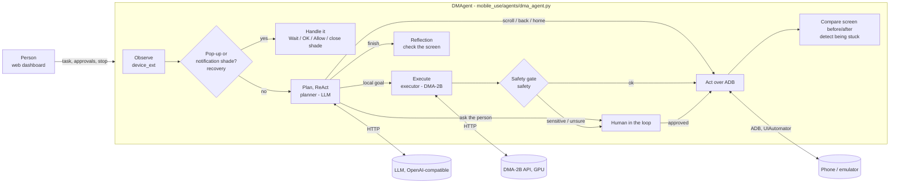

# DMAgent: an Android agent built from an LLM planner and the DMA-2B decision model

DMAgent runs tasks on an Android phone or emulator. An LLM plans, and DMA-2B, a 2B decision model, picks each action
in one forward pass with a probability attached. It is built on [MobileUse](https://github.com/MadeAgents/mobile-use)
(MIT) and reuses its ADB environment and agent interface. How to install and start it: [`dma_quickstart.md`](dma_quickstart.md).

## 1. Architecture

**One agent step does at most one thing on the device**, in this order:
1. **Budget and stop flag** (`safety.Policy`).
2. **Observe.** Take a screenshot and read the accessibility tree: uiautomator2 first, then `uiautomator dump`, then
   OCR text boxes if neither can read the screen.
3. **Self-correction.** Before planning, handle anything that interrupts the task:
   - an app that is not responding (Wait, or Close app the second time);
   - an app crash;
   - a permission dialog (allowed or denied by policy);
   - a one-button system notice;
   - the notification shade.
4. **Plan (LLM, ReAct).** The LLM writes a thought and picks one of seven moves:
   - give DMA-2B a local goal;
   - scroll;
   - press Back;
   - go Home;
   - answer the question;
   - ask the person;
   - finish. A finish is accepted only after a **reflection** call confirms that the current screen shows the task complete.
5. **Execute (DMA-2B).** One forward pass returns an action for the local goal, or "local goal done". It chooses the
   action, the element, the scroll direction, the app and the text to type, each with a probability.
6. **Safety gate.** A sensitive action (delete, send, pay, call, ..., in English or Vietnamese), or an action whose
   probability is below the threshold, waits for the person.
7. **Act over ADB**, then compare the screen before and after. The agent keeps the history. It reports **BLOCKED** to
   the LLM in three cases:
   - six actions pass without the local goal being done;
   - two actions in a row do not change the screen;
   - DMA-2B wants to click but no element matches.

**Why the planner does scroll, Back and Home itself.** These moves involve no element. DMA-2B learned them with
AndroidControl's conventions: its "scroll up" is the annotators' word for a swipe. Sent through DMA-2B, they were the
largest source of errors: "scroll up" was carried out as scroll down, and "press Back" became a click on Undo.

**Why the notification shade is closed.** DMA-2B's element list leaves out Android's system UI, as in training, so it
cannot see the shade at all. The agent closes the shade and tells the LLM to use the Settings app.

## 2. Requirements and where they are implemented

| Requirement | Code | Notes |
|---|---|---|
| Control protocol (ADB, UIAutomator, Accessibility) | `agents/dma/device_ext.py` | ADB through mobile-use's `adbutils` environment. The accessibility tree comes from uiautomator2, then `uiautomator dump`, then OCR |
| UI recognition (VLM, OCR, XML) | `device_ext.py`, DMA-2B | The XML gives the elements. OCR (RapidOCR) reads unreadable screens and, optionally, labels elements that have none. DMA-2B is a VLM that reads the screenshot and the element list |
| Control module: screenshot, UI extraction, tap / swipe / type | `device_ext.Device` | `screenshot`, `elements`, `act(click, long_press, type, scroll, back, home, open_app, wait, collapse_shade)`. Typing replaces the field's text and handles any script (uiautomator2's input method). The person's keyboard is restored after the task |
| Agent core with a VLM that chooses actions | `agents/dma/executor.py`, `agents/dma_agent.py` | DMA-2B chooses in one forward pass and generates no tokens |
| LLM reasoning: ReAct, planning, reflection | `agents/dma/planner.py` | JSON with a `thought` (ReAct), local goals (planning), `verify` before finishing (reflection) |
| Self-correction on errors and pop-ups | `agents/dma/recovery.py`, `dma_agent.py` | Dialog detection; notification-shade recovery; BLOCKED reports and stuck detection make the LLM re-plan; one ADB retry; an exception ends the step, not the task (3 in a row abort) |
| Safety and human in the loop | `agents/dma/safety.py` | Approval for sensitive actions (English and Vietnamese labels); a question to the person when p < 0.79; step and time budgets; stop flag |
| Control and monitoring interface | `mobile_use/dma_dashboard.py` | Task box; live screen (about 2 frames/s); timeline; approval panel; stop; earlier tasks. Click-to-tap, Back and Home while no task runs |
| App list for any device | `agents/dma/make_app_list.py` | Reads the launchable apps and their labels over ADB |
| Experiments: completion rate and performance | `benchmark/dma_scenarios/` | 20 tasks (12 tuned, 8 held out), each checked over ADB. Steps, time, LLM calls, latency and human requests are recorded |
| Tests | `tests/test_dma_agent.py`, `tests/test_dma_dashboard.py` | Fake device, LLM and model |

## 3. When to ask the person: a measured threshold

On AndroidControl-High (8,444 steps), we split the steps by the probability DMA-2B gives the action it chooses:

| Steps | Count | Wrong |
|---|---|---|
| p ≥ 0.79 (the agent acts) | 6,762 (80%) | 18.7% |
| p < 0.79 (the person is asked) | 1,682 (20%) | 54.3% |

AndroidControl-High gives the model only the overall goal. Inside the agent, DMA-2B also gets a local goal and is
usually more confident, so this threshold is on the cautious side.

Sensitive actions always need approval, whatever the probability: delete, send, share, pay, buy, call, uninstall,
reset, sign out, and their Vietnamese equivalents (xóa, gửi, thanh toán, chuyển tiền, gọi, gỡ cài đặt, đặt lại,
đăng xuất, ...). Labels with diacritics are matched against the accented words, so "Gói" (a plan) is not mistaken
for "Gọi" (call).

## 4. Experiments

See section 5 for the latest run.
