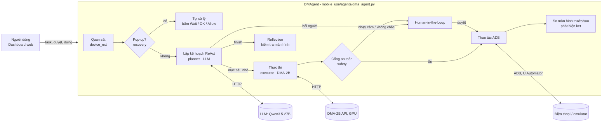

# DMAgent: tác tử tự thực thi tác vụ trên điện thoại (LLM + DMA-2B, trên nền mobile-use)

## 1. Kiến trúc



**Một bước của agent làm tối đa một thao tác trên thiết bị**, theo thứ tự:
1. **Ngân sách và nút dừng** (`safety.Policy`).
2. **Quan sát.** Chụp ảnh màn hình và lấy cây UI bằng UIAutomator. OCR là tuỳ chọn: chỉ dùng để gắn nhãn cho phần tử bấm được mà không có nhãn trợ năng.
3. **Tự sửa sai.** Nếu màn hình đang có hộp thoại chen ngang thì xử lý trước, ví dụ app không phản hồi, app bị crash, xin quyền, thông báo hệ thống.
4. **Lập kế hoạch (LLM, ReAct).** LLM suy nghĩ, rồi chọn một trong bốn bước: đưa mục tiêu nhỏ, trả lời câu hỏi, hỏi người, hoặc báo xong. Báo xong chỉ được chấp nhận sau một bước **Reflection** kiểm tra màn hình hiện tại.
5. **Thực thi (DMA-2B).** Mỗi lần gọi model là một lượt tính toán, trả về một thao tác cho mục tiêu nhỏ hoặc báo "xong mục tiêu nhỏ". Model chọn hành động, phần tử, hướng cuộn, app và chữ cần gõ, kèm xác suất cho từng lựa chọn.
6. **Cổng an toàn.** Thao tác nhạy cảm, hoặc thao tác có xác suất dưới ngưỡng, phải chờ người duyệt.
7. **Thực hiện qua ADB** rồi so màn hình trước và sau. Agent ghi lại lịch sử, báo **BLOCKED** cho LLM khi làm 6 thao tác mà chưa xong mục tiêu nhỏ, hoặc khi 2 thao tác liên tiếp không làm màn hình đổi.

## 2. Ánh xạ yêu cầu đề tài → mã nguồn

| Yêu cầu | Mã nguồn | Ghi chú |
|---|---|---|
| Giao thức điều khiển (ADB, UIAutomator, Accessibility) | `agents/dma/device_ext.py` | ADB qua `adbutils` của mobile-use; cây UI (Accessibility) lấy bằng uiautomator2, nếu không được thì `uiautomator dump`, cuối cùng là OCR |
| Nhận diện UI (VLM, OCR, XML) | `device_ext.py`, DMA-2B | XML để biết phần tử; OCR (RapidOCR) cho phần tử không có nhãn; DMA-2B là VLM đọc cả ảnh lẫn danh sách phần tử |
| Module điều khiển: chụp màn hình, trích UI, tap / swipe / type | `device_ext.Device` | `screenshot`, `elements`, `act(click, long_press, type, scroll, back, home, open_app, wait)` |
| Agent Core tích hợp VLM sinh hành động | `agents/dma/executor.py`, `agents/dma_agent.py` | DMA-2B chọn thao tác trong một lượt, không sinh token |
| LLM, chuỗi suy luận ReAct / Planning / Reflection | `agents/dma/planner.py` | JSON có `thought` (ReAct), mục tiêu nhỏ (Planning), `verify` trước khi báo xong (Reflection) |
| Tự sửa sai khi gặp lỗi hoặc pop-up | `agents/dma/recovery.py`, `dma_agent.py` | Nhận diện hộp thoại; báo BLOCKED và phát hiện kẹt để LLM lập kế hoạch lại; thử lại khi ADB lỗi |
| An toàn và Human-in-the-Loop | `agents/dma/safety.py` | Duyệt thao tác nhạy cảm; hỏi người khi p < 0,79; ngân sách số bước và thời gian; nút dừng |
| Giao diện điều khiển và giám sát | `mobile_use/dma_dashboard.py` | Màn hình trực tiếp, dòng thời gian, khung duyệt, nút dừng, lịch sử task |
| Thực nghiệm, đo tỉ lệ hoàn thành và hiệu năng | `benchmark/dma_scenarios/` | 12 kịch bản, kiểm tra kết quả bằng ADB; đo số bước, thời gian, số lần gọi LLM, độ trễ, số lần cần người |
| Kiểm thử | `tests/test_dma_agent.py` | 17 test với thiết bị, LLM và model giả |

## 3. Ngưỡng hỏi người: đo, không đoán

Trên AndroidControl-High (8.444 bước), xét xác suất model gán cho hành động nó chọn:

| Nhóm bước | Số bước | Tỉ lệ sai |
|---|---|---|
| p ≥ 0,79 (agent tự làm) | 6.762 (80%) | 18,7% |
| p < 0,79 (hỏi người) | 1.682 (20%) | 54,3% |

Ngưỡng này được đo trên AndroidControl-High (chỉ có mục tiêu chung). Trong agent, DMA-2B nhận thêm mục tiêu nhỏ nên thường chắc chắn hơn, vì vậy ngưỡng có thể hơi thận trọng.

Thao tác nhạy cảm luôn cần duyệt, bất kể xác suất: xoá, gửi, chia sẻ, thanh toán, mua, gọi, gỡ cài đặt, reset, đăng xuất...

## 4. Chạy

Hướng dẫn đầy đủ từng bước: [`dma_quickstart_vi.md`](dma_quickstart_vi.md).

```bash
# DMA-2B API trên máy có GPU: serving/d1_api.py (repo DMA-2B), kèm danh sách app đã cài (D1_APPS)
python -m mobile_use.dma_dashboard --dma-url http://<dma-api>:8700 --llm-url-file llm_url.txt \
    --llm-key-file llm_key.txt --apps-json app_list.json --serial emulator-5554 --port 7870
python benchmark/dma_scenarios/run_eval.py --dma-url ... --llm-url-file ... --llm-key-file ... --apps-json ... --out results/
python -m pytest tests/test_dma_agent.py
```

## 5. Thực nghiệm (16/11/2026)

**Thiết lập:** emulator Android 13 (Pixel 6, ảnh AndroidWorld); LLM Qwen3.5-27B, không bật thinking; DMA-2B chạy trên một RTX 4090; tối đa 30 bước hoặc 900 giây mỗi task. Trong lúc đo, mọi yêu cầu cần người duyệt đều được duyệt tự động và được đếm lại.

**Cách tính hoàn thành:**
- **Đạt theo thiết bị:** sau khi chạy, hàm kiểm tra trên thiết bị qua ADB trả về đúng.
- **Đạt chặt:** đạt theo thiết bị **và** agent tự báo xong (hoặc trả lời đúng) trước khi hết ngân sách.

| Lượt | Thay đổi so với lượt trước | Đạt theo thiết bị | Đạt chặt | Bước / task | Giây / task |
|---|---|---|---|---|---|
| 1 | — | 10/12 | 10/12 | 6,9 | 119 |
| 2 | Lỗi trong một bước không dừng cả task; màn hình không đọc được thì chờ; không gọi model khi thiếu phần tử | 11/12 | 10/12 | 8,9 | 175 |
| 3 | Cây UI lấy bằng uiautomator2 trước, rồi uiautomator dump, cuối cùng OCR | 12/12 | 10/12 | 14,8 | 119 |
| 4 | Planner có bước "scroll" với hướng rõ ràng; đóng hẳn app giữa các task | **12/12** | **11/12** | 10,2 | **84** |

**Kết quả từng task, lượt 4** (`benchmark/dma_scenarios/results/run4/`):

| Task | Đạt | Bước | Giây | Lần gọi LLM | Lần cần người |
|---|---|---|---|---|---|
| Tắt Wi-Fi | ✓ | 5 | 32 | 6 | 0 |
| Bật Wi-Fi | ✓ | 5 | 31 | 6 | 0 |
| Tắt Bluetooth | ✓ | 16 | 95 | 17 | 0 |
| Bật giao diện tối | ✓ | 5 | 29 | 6 | 0 |
| Bật Không làm phiền | ✓ | 26 | 399 | 89 | 5 |
| Đặt thời gian tắt màn hình 10 phút | ✓ | 6 | 37 | 7 | 0 |
| Tạo note Markor | ✓ (hết 30 bước, không tự báo xong) | 30 | 214 | 28 | 13 |
| Thêm dòng vào note | ✓ | 6 | 37 | 6 | 2 |
| Xoá note | ✓ | 5 | 31 | 6 | 1 |
| Thêm danh bạ | ✓ | 10 | 61 | 8 | 0 |
| Hỏi mức pin | ✓ ("100") | 1 | 3 | 1 | 0 |
| Hỏi phiên bản Android | ✓ ("13") | 7 | 36 | 7 | 0 |

**Hiệu năng:** DMA-2B mất 270 ms mỗi quyết định, LLM mất 1,3 giây mỗi lần gọi. Thời gian còn lại là chờ thiết bị (khoảng 1,5 giây sau mỗi thao tác) và đọc cây UI.

**Các lỗi tìm ra khi chạy thật, mỗi lỗi đã có cách sửa và test:**
- `uiautomator dump` báo "could not get idle state" trên màn hình không bao giờ đứng yên (trang About, ô soạn thảo có con trỏ nhấp nháy). Đã sửa bằng uiautomator2 rồi đến OCR.
- DMA-2B chọn click nhưng không có phần tử nào để bấm. Giờ được báo BLOCKED để LLM lập kế hoạch lại.
- "Scroll up" bị hiểu ngược nghĩa giữa LLM và DMA-2B, vì DMA-2B học theo quy ước của người gán nhãn AndroidControl. Đã chuyển việc cuộn sang planner, với hướng rõ ràng.
- Một bước lỗi (ví dụ HTTP 400) không còn làm dừng cả task.

**Human-in-the-Loop qua dashboard** (kiểm tra thật): task "Xoá note old_ideas". Agent dừng trước thao tác "click Delete" và hỏi người; sau khi được duyệt thì xoá xong (kiểm tra bằng ADB). Ảnh màn hình lúc chờ duyệt: `docs/assets_dma/dashboard_approval_screen.png`.

**Giới hạn:**
- Mỗi lượt chỉ có 12 task, mỗi task chạy một lần. Các bản sửa ở lượt 2–4 được rút ra từ chính các task này, nên lượt 4 là kết quả trên tập đã dùng để chỉnh harness, chưa phải tập kiểm tra độc lập.
- Ở lượt 1, số lần gọi LLM bị cộng dồn qua các task (lỗi đếm, đã sửa từ lượt 2).
- Số lần BLOCKED vẫn cao ở một số task (Không làm phiền: 73). Agent vẫn xong nhưng tốn bước.
