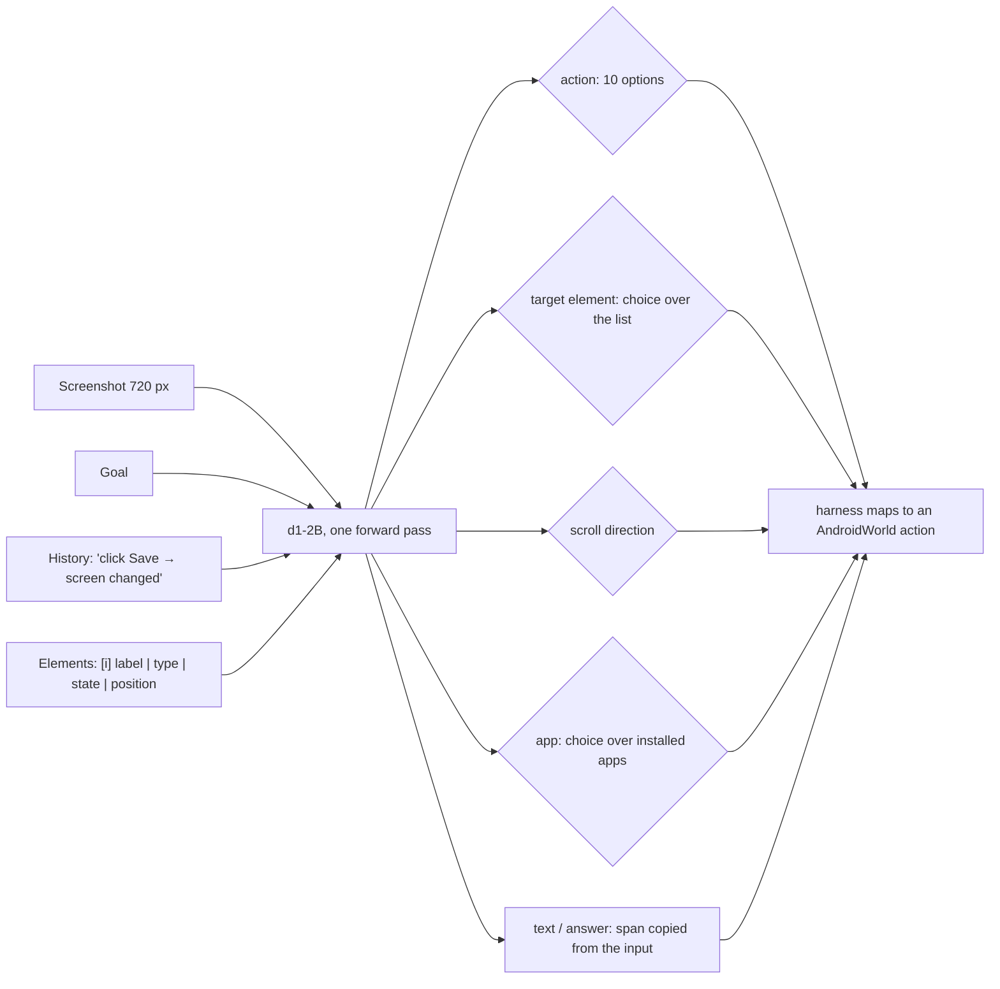

# A 2B Single-Pass Decision Model as a Mobile Agent: Per-Step Accuracy, Task Success, and What the Gap Is Made Of

*Draft, 2026-11-12. All numbers come from repository artifacts named next to them, and every rate carries its denominator. "Pending" marks a measurement that is running and is not claimed here.*

## Abstract

We fine-tune a 2B **decision model**, LiquidAI's d1-2B, into a mobile agent. At each step it reads the screenshot, the goal, its own action history and the screen's accessibility elements once, and answers typed questions in a single forward pass with **zero generated tokens**: which action, which element, which scroll direction, which app, and which span of the input to type or answer.

We train it on AndroidControl plus synthetic augmentation, plus 1,736 goal→app rows built from AndroidWorld's task generator. Those rows cover 97 of the 116 evaluated task templates, and no AndroidWorld rollout is used. We evaluate on AndroidControl and on the official AndroidWorld protocol (116 tasks, seed 30, one attempt). The model:

- **AndroidControl-High:** **61.7%** of steps right (5,213/8,444), but only **22.3%** of episodes with every step right (344/1,543).
- **AndroidControl-Low:** **89.3%** of steps (7,544/8,444) and 60.4% of episodes (932/1,543).
- **AndroidWorld:** a score of **25/115 = 21.7%** (24 full successes + 2 half credits), at a median **135 ms** per decision.

The AndroidControl episode-level rate and the AndroidWorld rate are almost the same, although the per-step number suggests far more. We analyse what the gap is made of:

- **Per-step vs episode:** AndroidControl-High per-step accuracy is teacher-forced and never checks the goal. Whole-episode accuracy falls from 59% on 1-step episodes to 9.4% on episodes of six or more steps.
- **Failed tasks:** of the 91 failed AndroidWorld tasks, 51 ended with the model declaring the task done when it was not (49 scored zero, 2 got half credit) and 40 ran out of step budget. A trace-level reading of all 91 estimates that about 36 are blocked by our constraints (one model, no planner, AndroidControl-only data): arithmetic, date computation, memory across screens, text that exists only in pixels, and information the accessibility tree does not carry.
- **Harness and environment:** harness and environment changes moved the score as much as model changes did. On the same checkpoint they raised the score from 15.5/115 to 25/115 (paired: 5 wins / 0 losses, then 5 wins / 1 loss).
- **Vision:** replacing every screenshot with a grey image drops validation step accuracy from 519/827 to 337/827, so the model uses the image, mostly to decide *what kind* of action to take.

We report the negative results alongside the positive ones.

## 1. Introduction

Mobile GUI agents are almost always **generative**: a VLM writes a thought and an action string at every step, often across several calls (planner, actor, reflector). A **decision model** works differently. It reads the state once and returns calibrated probabilities over options that the caller supplies, with no generated text [typesafe2026systemone; liquidAI2026opend1]. The appeal for an on-device agent is latency, a schema that cannot be violated, and calibrated confidence. The open question is whether such a model can *act*, not only classify.

We answer with measurements rather than a leaderboard claim. The paper makes four contributions:

1. A **decision contract** for mobile control: state, typed questions and pointer-copy outputs. The same code renders it at training and serving time.
2. Results on AndroidControl (Low and High) and on AndroidWorld under the official protocol, with every denominator.
3. A decomposition of the gap between per-step accuracy and task success, from a trace-level reading of all 91 failed AndroidWorld tasks.
4. A record of what did **not** work, and of the harness and environment defects that silently changed scores.

## 2. Related work

**Generative mobile agents.** Most published AndroidWorld results come from generative VLM agents:
- M3A, the AndroidWorld reference agent, uses an LLM summary per step as memory: 30.6% with GPT-4 Turbo [androidworld2024].
- UI-TARS reports 46.6% [uitars2025].
- MAI-UI reports 49.1% at 2B and 76.7% at 235B, "without … external tools" [maiui2026].
- GUI-Owl-7B reports 66.4%, and Mobile-Agent-v3, a multi-agent framework around GUI-Owl-32B, reports 73.3% [guiowl2025].
- UI-Venus-1.5-2B reports 55.6% [uivenus15-androidworld].
- MobileRL-9B reaches 80.2% with online RL on generated AndroidWorld task variants [mobilerl2025].
- V-Droid (59.5%) trains on AndroidWorld apps and tasks [vdroid2025].
- AndroidGen (46.8% with GPT-4o) collects its training trajectories in the AndroidWorld emulator, and its retrieval database grows during evaluation [androidgen2025].

These are **not comparable** to our number. They differ in model size, number of calls per step, generated reasoning, tools, use of AndroidWorld-derived training data, and in some cases the task count: AndroidGen's percentages fit 111 tasks, not 116 (our derivation). We give them as context only (AGENTS.md M4).

**Published AndroidWorld results, for context (not a ranking).** Each paper reports its own numbers. None were produced by our harness. The columns show why they are not directly comparable.

| Agent / model | Params | Model calls per step | Generates text | AndroidWorld-derived training data | Extra components | AndroidWorld SR | Source |
|---|---|---|---|---|---|---|---|
| **Ours: d1-2B decision model (v4)** | 2B | 1 | **no** (0 tokens) | goal→app rows from the task generator, 97/116 templates (`awgen`, §4) | none | **21.7%** (score 25/115) | this paper |
| M3A, GPT-4 Turbo | – | ≥2 (action + summary) | yes | no | step summary as memory | 30.6% | [androidworld2024] |
| UI-TARS | – | 1 | yes | not stated | – | 46.6% | [uitars2025] |
| AndroidGen, GPT-4o | – | several | yes | trajectories collected in AndroidWorld; retrieval database grows during evaluation | planner, retrieval, checks | 46.8% (its percentages fit 111 tasks: our derivation) | [androidgen2025] |
| MAI-UI-2B | 2B | 1 | yes | not stated | none ("without … external tools") | 49.1% | [maiui2026] |
| UI-Venus-1.5-2B | 2B | 1 | yes | not stated | – | 55.6% | [uivenus15-androidworld] |
| V-Droid | 8B verifier + LLM | several | yes | "apps and tasks from the AndroidWorld benchmark" | verifier over candidate actions | 59.5% | [vdroid2025] |
| GUI-Owl-7B | 7B | 1 | yes | not stated | – | 66.4% | [guiowl2025] |
| Mobile-Agent-v3 (GUI-Owl-32B) | 32B | several | yes | not stated | manager, worker, reflector, notetaker | 73.3% | [guiowl2025] |
| MAI-UI-235B-A22B | 235B (22B active) | 1 | yes | not stated | none | 76.7% | [maiui2026] |
| MobileRL-9B | 9B | 1 | yes | online RL on generated AndroidWorld task variants | – | 80.2% (average of 3 runs; pass@k reported separately) | [mobilerl2025] |

"–" means the field was not checked in the source. All entries are one model's self-reported pass@1 on the official task suite, unless noted. The closest setting to ours, a 2B end-to-end model with no tools, is MAI-UI-2B (49.1%) or UI-Venus-1.5-2B (55.6%), and both generate text. The difference from them is the question this paper does not answer: we have not run a generative 2B model on our harness.

**Decision models.** TypeSafe's Jev and LiquidAI's d1 answer typed questions (choice, yes/no, score, spans, boxes) in one pass [typesafe2026systemone; liquidAI2026opend1]. TypeSafe documents that such models should "keep math in code, which includes counting and date comparison" [typesafe-jev-limits-2026]. Our failure analysis reaches the same conclusion from the agent side (§5.8).

**Data and per-step benchmarks.** AndroidControl provides goal-level (High) and step-level (Low) instructions over 15,283 demonstrations [androidcontrol2024]. Its scorer compares each step with the demonstrator's action, given the demonstrator's history. AndroidControl-Curated cleans the test set and reports a per-step "success rate" [androidcontrolcurated2025]. AMEX adds element-level annotation and reports only per-step accuracy [amex2024]. Neither measures whether a task was completed.

## 3. The decision contract

- **State.** Each step's input is the screenshot plus a text state: the goal, a progress line, the current app, the previous actions with the observed effect of each ("→ screen changed" / "→ no change"), and the element list rendered from the accessibility tree. The same function (`ac_common.element_inputs_v3`) renders the state at training, evaluation and serving time.
- **Questions.** The questions are typed choices: action ∈ {click, type, long_press, scroll, wait, back, home, open_app, done, answer}, the target element, the direction, and the app. Typed text and answers are **pointer reads**: spans copied from the text state. In d1, the `text`, `number` and `date` question types read positions of the text input only, so the model cannot output text that appears only in the pixels (§5.8).
- **Harness.** The harness implements AndroidWorld's official protocol (`suite_utils` seeding, partial credit, the agent's own termination, no oracle stop). It records the agent policy in every episode header.

## 4. Training

- **Starting point and schedule.** We fine-tune all parameters of d1-2B except the tied embedding / LM head, which is frozen. This includes the vision encoder: 132/132 vision tensors change from the base (`benchmarks/results/2026-11-12-imgablate/weights_changed.md`). The run lasts one epoch: 2,482 steps × 16 rows, lr 1e-5, contract v4.
- **Data: 37,977 rows from AndroidControl's train split,** selected from task kinds similar to AndroidWorld's and rebuilt from the original files, with test episodes excluded. The rows are augmented with:
  - effect-labelled history;
  - "no change" rows that teach not to repeat an action that changed nothing;
  - avoid rows;
  - step-instruction rows (the AndroidControl-Low instruction shown on a fixed half of the rows);
  - answer episodes.
- **Disclosure: 1,736 `awgen` rows.** These rows map **goal text generated by AndroidWorld's own task generator** to the app to open. They cover **97 of the 116** evaluated templates; 19 are held out. No AndroidWorld rollout, screen or checker is used, but the rows do expose the model to AndroidWorld's goal phrasing and app names for most tasks. A split of success on held-out vs covered templates is not reported here.

## 5. Experiments

### 5.1 Setup and metrics

| Benchmark | Unit | Scorer |
|---|---|---|
| AndroidControl-High | step and whole episode, 1,543 episodes / 8,444 steps | InfiGUI's scorer, unchanged (`benchmarks/train/score_actest.py`) |
| AndroidControl-Low | step and whole episode, with the step instruction shown | same |
| AndroidWorld | task, 116 tasks, seed 30, pass@1 | official checker; SR = score sum / scored tasks (partial credit counts) |

The policy is argmax, but the environment is not deterministic: same-host replays diverged on 6/20 trajectories in an earlier check. We ran **one attempt per task (pass@1)**, whereas MobileRL reports pass@k over 8 sampled attempts.

### 5.2 Main results

| Model | AC-High step | AC-High episode | AC-Low step | AC-Low episode | AndroidWorld SR |
|---|---|---|---|---|---|
| d1-2B, untrained (same questions) | *pending* | *pending* | *pending* | *pending* | not run |
| **v4 (ours)** | **61.7%** (5,213/8,444) | **22.3%** (344/1,543) | **89.3%** (7,544/8,444) | **60.4%** (932/1,543) | **21.7%** (25/115) |

**Sources:**
- AndroidControl columns: `benchmarks/results/2026-11-12-v4/actest/perstep-v4_s0_ckpt_2482_actest_v4{,_low}.jsonl`.
- AndroidWorld column: harness V12, traces in `benchmarks/results/2026-11-12-maskenv/androidworld_maskenv.tgz`.
- One AndroidWorld task, OsmAndMarker, failed at environment setup and is excluded; the defect is fixed (§5.5).

For reference: on the earlier harness, an agent that declares "done" at step 0 scores 7/113 (6.6%), because some tasks start already satisfied.

### 5.3 Per-step accuracy is not task success

The AndroidControl-High scorer feeds the demonstrator's history and screen at every step (`eval_d1.py:42,48-49,220-225`). It never checks the goal, so errors cannot compound. Whole-episode accuracy shows the compounding that per-step accuracy hides:

| Episode length (steps) | 1 | 2 | 3 | 4 | 5 | 6 | 7 | 8 | 9 | ≥10 |
|---|---|---|---|---|---|---|---|---|---|---|
| All steps right | 69/116 | 37/122 | 70/200 | 60/221 | 49/256 | 19/173 | 18/138 | 11/102 | 4/65 | 7/150 |
| % | 59 | 30 | 35 | 27 | 19 | 11 | 13 | 11 | 6 | 5 |

The whole-episode rate on AndroidControl-High (22.3%) is close to AndroidWorld's (21.7%). They are still different quantities:
- AndroidWorld is **harder** in that errors compound, the agent must stop by itself, and 13 of its 20 apps have no training goals.
- AndroidWorld is **easier** in that any path to the goal state is accepted.

The two effects happen to roughly cancel here. The episode-level rate is the better offline proxy.

Termination is a large part of the gap. The AndroidControl test set contains **no** step where "done" is the right answer, yet the model predicts it on **1,171/8,444** steps. Of these, 460 fall on an episode's last real step and 566 on steps whose gold action is a scroll. The two groups overlap by 186 steps, so they should not be added.

### 5.4 AndroidWorld by difficulty, complexity and steps

Difficulty labels and optimal step counts are from upstream `task_metadata.json` (61 easy, 36 medium, 19 hard). The table is generated by `benchmarks/aw/aw_report.py`.

| Difficulty | Scored | Score | SR | Avg steps | Avg steps (success) | Avg steps (failure) | Avg optimal steps |
|---|---|---|---|---|---|---|---|
| easy | 61 | 21.0 | 34.4% | 8.5 | 5.5 | 10.1 | 5.0 |
| medium | 36 | 3.0 | 8.3% | 13.0 | 6.7 | 13.6 | 9.0 |
| hard | 18 | 1.0 | 5.6% | 19.3 | – | 19.3 | 18.5 |
| **all** | **115** | **25.0** | **21.7%** | 11.6 | 5.7 | 13.2 | 8.4 |

| Complexity level (ceil of task complexity, as in MobileRL) | C1 (45) | C2 (41) | C3 (9) | C4 (21) |
|---|---|---|---|---|
| SR | 19/45 = 42.2% | 5.5/40 = 13.8% | 0/9 | 0.5/21 = 2.4% |

The "avg optimal steps" column averages over all scored tasks in a row. On the tasks the model actually solved, it took 5.5 steps on easy tasks against an optimum of 3.2 for those same tasks, and 6.7 against 5.0 on medium. Its successes are therefore not on the shortest path. Our level counts (45/41/9/21) differ from those MobileRL reports for the same definition (49/41/11/15, read from its figure).

### 5.5 The harness and the environment move the score as much as the model

Same checkpoint (v4), same seed, paired per task:

| Harness | Score | vs previous row | What changed |
|---|---|---|---|
| V8 | 15.5/115 | – | – |
| V11 | 20.5/115 | 5 wins / 0 losses (p = 0.062) | the answer reached the checker's cache (every answer had scored 0); fresh observation when the accessibility tree lagged the pixels (8 s cap); the agent policy is now logged per episode (logging, not a fix) |
| V12 + environment | **25/115** | 5 wins / 1 loss (p = 0.22) | fresh-wait trigger on page change (cap 8 → 20 s); working SIM (IPv6 container network); Chrome first-run screens clicked through before the suite |
| V14 + Markor/OsmAnd repairs | *pending* (39 affected tasks re-run; other 77 tasks unchanged by construction) | | numeric answer format; Back to close the keyboard after typing; emulator app-state checks |

**Environment defects found from traces:**
- **Markor** opened on its first-run screens in 6/6 Markor episodes on one emulator.
- **OsmAnd:** running `sqlite3` as root on a missing database left a 0-byte root-owned `map_markers_db`. OsmAnd could not open it, so OsmAndMarker failed setup in 3 of 4 runs.
- **VLC:** the media library stays "Loading" on every emulator. The log shows the library refusing a folder after the task's own setup clears the Media table as root, so the cause is *inferred* (`benchmarks/results/2026-11-12-failanalysis/vlc_investigation.md`). The Browse tab still reaches the files.
- **Accessibility service:** `uiautomator dump` kills AndroidWorld's accessibility forwarder.

Each of these produces failures that look like model failures.

### 5.6 The model uses the image

On validation (827 steps, v4), every screenshot was replaced by a uniform grey image of the same size:

| | Real | Grey |
|---|---|---|
| Step accuracy | 519/827 | 337/827 |
| Action-type accuracy | 80.0% | 50.8% |
| Grounding (element, given the right type) | 65.5% (271/414) | 59.9% (124/207) |
| type_text right | 37/53 | 3/53 |
| scroll right | 40/86 | 7/86 |

The image mostly affects **what** to do: action-type accuracy falls by 29 points, and type_text and scroll collapse. Our reading is that the model looks for a keyboard or a long list, but that is an interpretation, not a measurement. The element choice, given the right type, falls less, on different subsets. Source: `benchmarks/results/2026-11-12-imgablate/`.

### 5.7 Latency

On 1,335 AndroidWorld steps, the model takes **135 ms** per decision at p50 and 181 ms at p95. That covers one forward pass on a shared 24 GB GPU, served over HTTP. The environment step takes 1,624 ms at p50, so the agent loop is dominated by the device, not the model.

### 5.8 What the 91 failed tasks are made of

Four independent LLM agents (one per group, no shared context) each took one group of failed tasks. For every task they found the first wrong step in the trace and screenshots, and checked the upstream checker (`benchmarks/results/2026-11-12-failanalysis/*.tsv`).

| Group (failed tasks) | Main causes (tasks) |
|---|---|
| Information retrieval (21) | answer visible but never given (4) · answer format (1) · wrong navigation (4) · date, time or colour reasoning (4) · counting across screens (2) · answer not expressible by the contract (6) |
| Easy (27) | long press needed (5) · *Verify* tasks already satisfied (3: two flipped back, one never declared done) · premature done (4) · wrong element (4) · target scrolled off screen (3) · typing replaces instead of appends (2) · clipboard chip filtered out (2) · environment / app knowledge (4) |
| Medium/hard (34) | app procedure (7) · values that must be computed, e.g. dates and end times (6) · stops after the first of several items (4) · environment (3) · form fields not filled (3: two hidden by the keyboard, one needing a horizontal scroll) · duplicates across screens (3) · long note content (2) · VLC (2) · single cases (4) |
| Visual (9) | navigation, no reading needed (2) · drawing or maze pages (2) · text only in pixels (4) · arithmetic (1) |

**About 36 of the 91 failures (an estimate from the group reports, not a per-task tally) are blocked by our constraints (one model, no planner, AndroidControl-only data):**
- arithmetic and date computation;
- memory across screens (counting, duplicates, transcription);
- text that exists only in pixels;
- colour or icon semantics with no training labels;
- information the accessibility tree does not carry (e.g. screen brightness), and inputs the data cannot teach (keyboard clipboard chips, appending to a field).

These are the capabilities that TypeSafe's own guidance assigns to code rather than to the model [typesafe-jev-limits-2026]. A deterministic tool layer (§7) is the natural next step.

### 5.9 Negative results

| What we tried | Result | Strength of evidence |
|---|---|---|
| A threshold gate on p(done) | harmful at every threshold (AC-v2) | measured |
| A separate "is the task done?" yes/no head | redundant: on AndroidControl its label equals "action = done" on 137/137 rows | measured |
| Masking an action already marked "no change" | 2 wins / 2 losses on AndroidWorld; premature stops rose | measured, one run |
| Weight merge 0.3·v3 + 0.7·v4 | 6 wins / 9 losses vs v4 | measured, one run |
| Recovery ("go back") rows | pilot (300 steps): validation step accuracy 65.2% → 57.7%, back predicted where gold is not back 1.9% → 10.0% (`2026-11-12-recovery/gate2_pilot1.out`) | measured on the pilot; the full runs were not finished |
| "Already satisfied → done" rows | like-for-like at ckpt_250: false "done" 108/690 with the rows vs 67/690 without (but 106/690 after removing them again in a third run) | not evidence: the third run contradicts the attribution |
| Early-warning rule at 10% of training | invalid: on v3's own run, mid-training metrics do not predict final ones (back misuse 34 → 18; false done 49–52 → 31) | measured (AGENTS.md M17) |

### 5.10 Zero-shot pattern probes (current model, no training)

| Pattern | Validation (827 rows; 430 with a target) | AndroidControl sample (2,012 rows; 1,224 with a target) |
|---|---|---|
| Element by the trained choice (argmax) | 286/430 | 821/1,224 |
| Re-rank top-5 with one yes/no question per candidate | 261/430 | 772/1,224 |
| Gold element within top-5 | 388/430 | 1,084/1,224 |
| "Did the last action move toward the goal?" on the next screen, AUROC | 0.68 (10 negatives) | **0.76** (1,550 positives / 26 negatives) |

Without training, per-candidate re-ranking does not help, although the top-5 holds the gold element on about 90% of rows. The next-screen progress question already separates good from bad transitions zero-shot; this result rests on only 26 negatives. Source: `benchmarks/results/2026-11-12-patterns/`.

## 6. Limitations

- **Statistical power:** one seed and one attempt per task. A ±5-task difference on AndroidWorld is within noise (sign test p ≈ 0.2 at 5/1).
- **Benchmark-derived data:** the `awgen` rows use AndroidWorld goal templates (§4).
- **Pending results:** the untrained-base numbers, the V14 harness result and a retrained model.
- **No live comparison with a generative model** of the same size on the same harness. Published numbers are context, not comparisons (§2).
- **Failure-taxonomy rigour:** the taxonomy was produced by four LLM agents (one per group) reading traces and screenshots, without a second reader or inter-rater agreement.

## 7. Conclusion and next steps

A 2B decision model can operate a phone end to end at 135 ms per decision. Its per-step accuracy on AndroidControl overstates its task success by a factor of about three. Its episode-level accuracy and its AndroidWorld success are both near 22%.

The gap is made of three things:
- **termination:** 51 of 91 failures ended with a wrong "done";
- **harness and environment defects**, worth as much as model changes;
- **capabilities a single pass should not be asked to provide:** arithmetic, dates, memory and pixel text.

TypeSafe's own guidance points the same way: keep the model for judgments and put computation in code. Our next step follows from that, in this order:
1. **Next-screen progress verification**, which already shows signal zero-shot.
2. **Trained per-candidate re-ranking.**
3. **A map–reduce answer path:** the model judges each row, code counts, sums and formats.

## Sources

- AndroidWorld — https://arxiv.org/abs/2405.14573 ; leaderboard snapshot `references/raw/androidworld-leaderboard-2026-11-12.csv`
- AndroidControl — https://arxiv.org/abs/2406.03679
- AndroidControl-Curated / Magma-R1 — https://arxiv.org/abs/2510.18488
- AMEX — https://arxiv.org/abs/2407.17490
- MobileRL — https://arxiv.org/abs/2509.18119
- AndroidGen — https://arxiv.org/abs/2504.19298
- MAI-UI — https://arxiv.org/abs/2512.22047
- GUI-Owl / Mobile-Agent-v3 — https://arxiv.org/abs/2508.15144
- UI-TARS — https://arxiv.org/abs/2501.12326 ; UI-TARS-2 — https://arxiv.org/abs/2509.02544
- V-Droid — https://arxiv.org/abs/2503.15937
- Mobile-Agent-v2 — https://arxiv.org/abs/2406.01014 ; Mobile-Agent-E — https://arxiv.org/abs/2501.11733
- Agent S2 — https://arxiv.org/abs/2504.00906 ; Agent S3 — https://arxiv.org/abs/2510.02250
- UI-Venus-1.5 (2B AndroidWorld 55.6%) — ledger `uivenus15-androidworld`
- TypeSafe Jev — https://typesafe.ai/blog/introducing-system-one-models-and-jev ; limits — https://docs.typesafe.ai/model-jaggedness/jev-1.13 ; cookbooks — https://docs.typesafe.ai/cookbooks/
- LiquidAI d1 — ledger `liquidAI2026opend1`
